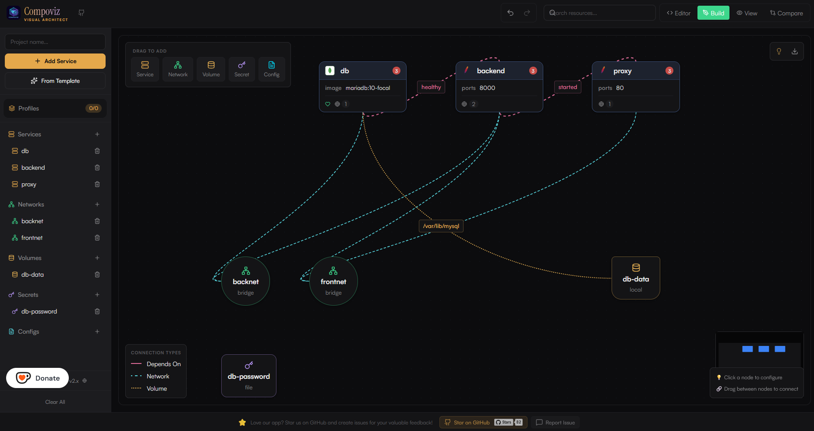
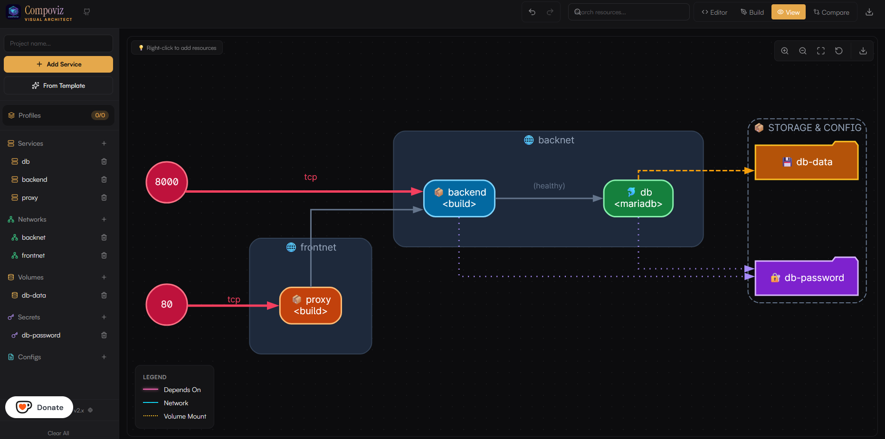
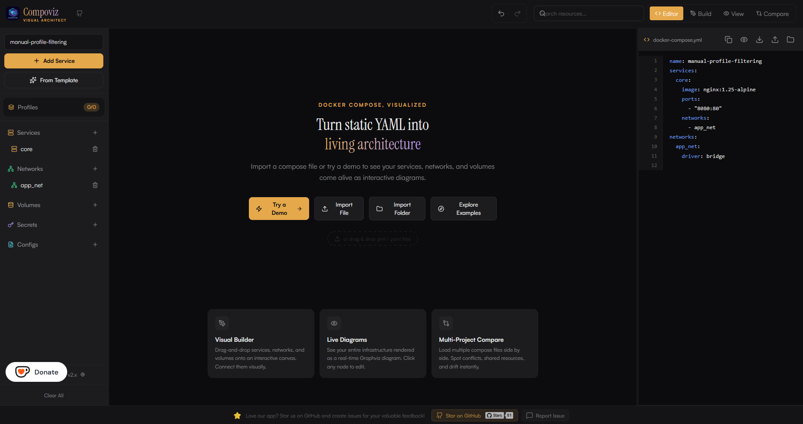
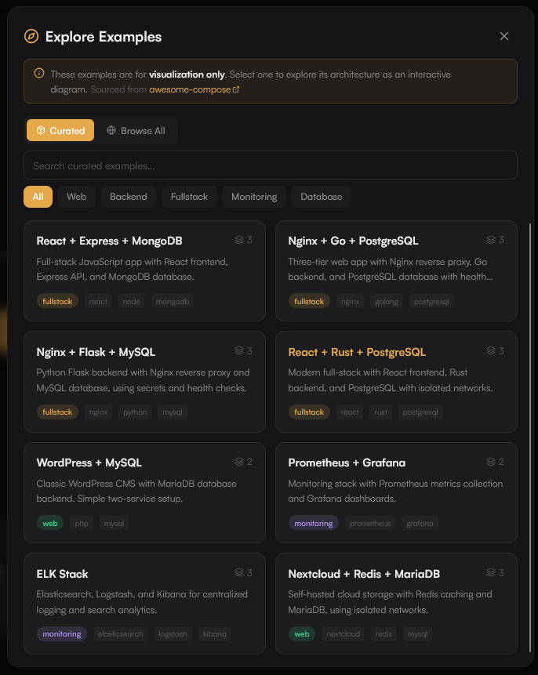

# Compoviz

**See the architecture behind your Docker Compose files.**

Compoviz is an open-source, browser-based workspace for exploring, editing, and visualizing Docker Compose projects. See how your services fit together, build stacks visually, compare configurations, and learn from real examples.

**[Open Compoviz](https://compoviz.pro)** · **[Self-host](#self-host)** · **[Explore examples](#explore-real-compose-projects)** · **[Contribute](CONTRIBUTING.md)**

No account required. Compose files you import are processed in your browser. [MIT licensed](LICENSE).



*An actual Compose project in Build mode. Select nodes to edit them, or connect resources on the canvas.*

---

## From Compose YAML to a picture you can work with

### Understand what's connected

Import a Compose file or project folder and switch to **View** for a structured diagram of services, networks, dependencies, published ports, and storage.



### Build and edit without losing the YAML

Use **Build** to add services, networks, volumes, secrets, and configs on an interactive canvas. Start from a service template or edit the Compose definition directly in **Editor**.



### Explore real Compose projects

Not sure where to start? Open the **Examples Explorer** to browse curated stacks or load more from [docker/awesome-compose](https://github.com/docker/awesome-compose). Search by stack or category, select an example, and inspect its architecture without cloning a repository.



For supported examples and uploaded project folders, Compoviz can inspect Dockerfiles referenced by `build:` and show resolved base-image information in the diagrams. Resolution is best-effort; it doesn't inspect running containers or built images.

---

## More than a diagram

| | What you can do |
| --- | --- |
| **Compose-aware parsing** | Work with `include`, `extends`, variables, profiles, and multi-file projects. |
| **Visual builder** | Add and connect resources with drag and drop, or start from templates. |
| **Architecture view** | See service dependencies, network grouping, ports, volumes, secrets, and configs. |
| **Compare projects** | Inspect up to three Compose projects, including potential port and resource conflicts. |
| **Examples Explorer** | Browse real-world stacks and explore Dockerfile base-image details where available. |
| **Local-first workflow** | Import and work with your own Compose files without uploading them to a Compoviz backend. |

Compoviz visualizes **declared configuration**. It is not a container runtime monitor, vulnerability scanner, or replacement for `docker compose config` and deployment-time validation.

## Try it

**In your browser:** [compoviz.pro](https://compoviz.pro) — open an example or import a Compose file. No registration or installation.

### Self-host

Run the published image:

```bash
docker run -d --name compoviz -p 8080:80 ghcr.io/adavesik/compoviz:latest
```

Open **http://localhost:8080**.

Compoviz itself doesn't need a server-side application API to process your Compose files. Features that browse remote examples fetch those resources from GitHub when used.

### Run locally for development

```bash
git clone https://github.com/adavesik/compoviz.git
cd compoviz
npm install
npm run dev
```

Run the checks before submitting a change:

```bash
npm test
npm run lint
npm run build
```

## Under the hood

Compoviz is built with React and Vite. The interactive builder uses React Flow, while the architecture view is generated from a multi-stage Compose parser. Parsing work is moved off the main UI thread with Web Workers.

If you want to dig deeper, start with the [source code](src/), [contribution guide](CONTRIBUTING.md), and [changelog](CHANGELOG.md).

## Contributing and feedback

Compoviz is an independent open-source project. Bug reports, Compose edge cases, documentation improvements, and pull requests are welcome.

- [Report a bug or propose an improvement](https://github.com/adavesik/compoviz/issues)
- [Ask a question or share an idea](https://github.com/adavesik/compoviz/discussions)
- [Read the contribution guide](CONTRIBUTING.md)
- [See releases](https://github.com/adavesik/compoviz/releases)

**License:** [MIT](LICENSE) · **Live app:** [compoviz.pro](https://compoviz.pro)
